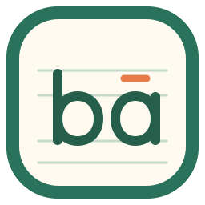

# 爱拼音 · Love Pinyin

爱拼音帮助一年级孩子跟着学校进度学习汉语拼音。孩子可以听示范、做有声练习、观察笔顺，也可以在游戏里巩固。题目有声音引导，孩子不必先认识题目中的汉字。课程按中国大陆统编人教版课序组织，无广告、排行榜或云账号。

## 安装

前往 [下载页面](https://github.com/yizhouxw/love-pinyin/releases)，选择适合自己电脑的安装包。应用把课程和声音保存在本机，普通学习不需要联网。

- **Mac（Apple 芯片）**：下载 `LovePinyin-arm64.dmg`，打开后把“爱拼音”拖入“应用程序”，再打开它。暂不支持 Intel Mac。
- **Windows（x64）**：下载 `LovePinyin-windows-x64-setup.exe`，运行安装程序后从开始菜单打开。需要 Windows 10 或 11 和已安装的 Microsoft Edge。Windows 安装包请以下载页面实际提供为准。

安装包目前没有开发者签名；Mac 也没有公证。系统可能提示无法验证开发者或未知发布者，请确认文件来自上面的官方下载页面，再按系统安全提示操作。

## 开始学习

1. 打开爱拼音；浏览器访问可以先选择访客体验，访客进度仅保存在当前页面，退出后清除。
2. Mac 应用会自动建立家庭档案并保存进度；浏览器访问则需生成配对码并完成配对。进入“家长管理”选择孩子正在学习的课程。
3. 首页可进入课堂学习、天天练和游戏乐园。孩子可以点击声音按钮重听，听不清或播放失败时可以重试或跳过。
4. 家长可查看学习记录、调整声音和游戏时长，也可以在家长管理中下载备份；换电脑时使用备份恢复。

## 可以做什么

- **听、写、练**：跟随 14 课学习声母、韵母和拼读，听标准音、观察四线格笔顺，再通过有声题目练习。
- **天天练拼音**：选择每日练习，逐条听读或连播；可以调整跟读间隔，也可以选择录音回放。
- **游戏乐园**：在跑酷、划船、节奏和投递游戏中练习拼音。家长可设置每天和每次的游戏时长。
- **拼音小卖部**：以模拟体验逛商店；目前商品自动加入购物篮，**不是真实语音识别**，也不记录学习成绩。

## 可选的跟读识别

天天练可以选择录音，并用电脑上的 Whisper 模型对照识别出的音节。首次使用前，家长可在本机“家长管理”中点击“下载模型”；下载约 488 MB，需要联网。没有模型也可以正常听读、练习和录音回放。

识别只用于音节对照，**不评价四声或专业发音准确度**；听不清或识别不可用时不会判孩子错误。录音只在设备和本机服务的内存中处理，不保存到家庭档案。

## 家庭数据与其他设备

进度保存在运行应用的电脑上，不需要云账号。建议家长定期在“家长管理”下载备份。

- Mac 应用数据位于 `~/Library/Application Support/LovePinyin/`。
- Windows 应用数据位于 `%LOCALAPPDATA%\LovePinyin`。

更新或卸载应用不会删除这些目录。桌面应用默认只供本机使用。如需 iPad 或手机通过家庭网络连接，请参阅[家庭局域网部署说明](docs/engineering/local-deployment.md)；完整移动设备、家庭网络和家庭试用验收仍在进行。

Mac App 与另行部署的 Web 版本可同时运行，使用各自的数据和会话；App 自动选择本机空闲端口。两个版本不会自动同步进度，可使用备份手动迁移。

## 帮助与许可

如果没有声音，请检查电脑音量，并在页面重试播放。如果应用无法启动，请关闭后重新打开。源码运行、Docker、开发和验证方法见[开发与维护参考](docs/engineering/developer-reference.md)；交付状态见[状态与剩余验收](docs/STATUS.md)。

代码、文档与原创题目采用 [MIT 许可](LICENSE)；课程录音、教材素材、字体及其他第三方内容保留各自许可，详见[第三方说明](THIRD_PARTY_NOTICES.md)。
