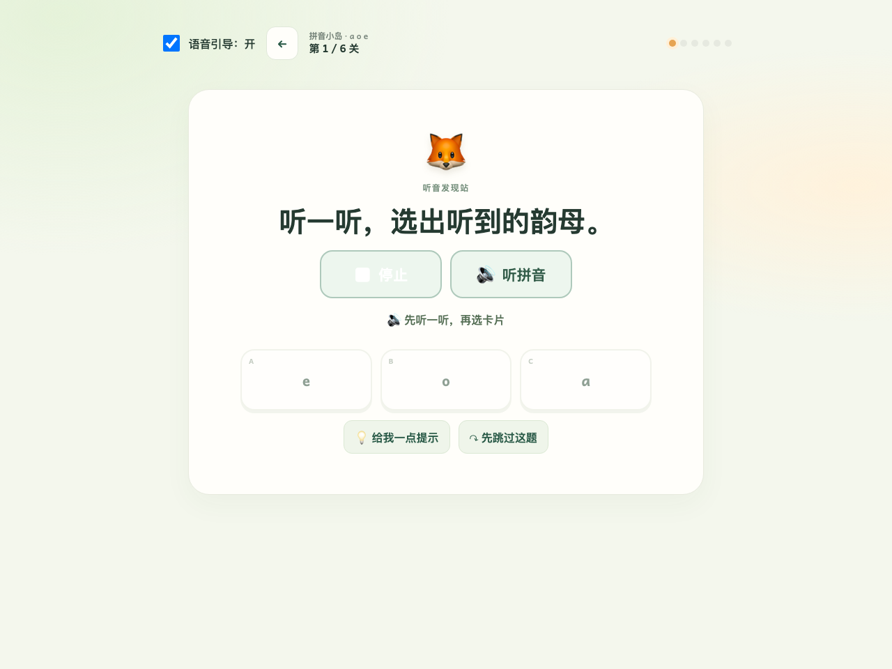
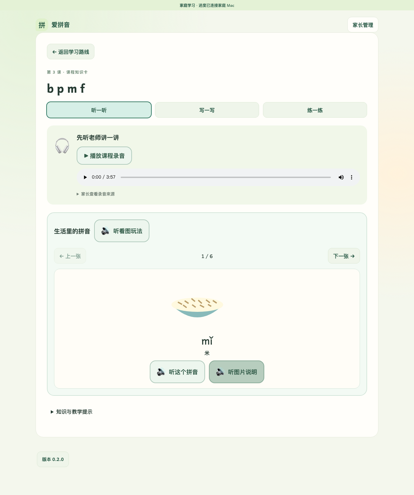
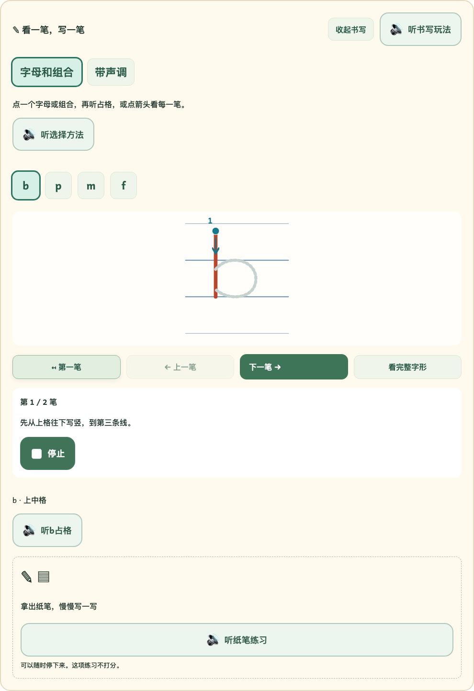
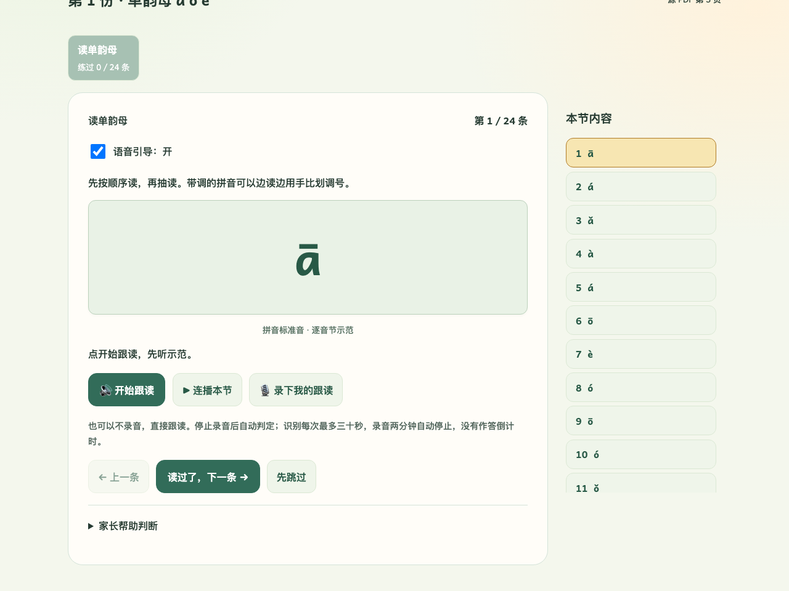

# 爱拼音 · Love Pinyin

面向刚开始学习拼音的一年级学生与家长，按中国大陆统编人教版课序学习。浏览器提供语音引导、听辨、声调、拼读和字形游戏；自有 Mac Studio 通过同源 API 提供声音、课程和 SQLite 家庭进度。课程不录音、不做发音评测，不需要云账号。新增“天天练拼音”按用户PDF提供14份每日练习，可自愿在浏览器内存录音回放；并支持本地语音识别匹配判定，不提供专业发音/四声评分。

当前已实现14课、83个知识点和448道客观题，含课程录音、逐目标标准音、题目/提示/反馈朗读、书写观察、生活图片卡，以及家长备份恢复。桌面已有实际 Chrome/Safari 验收记录；**家庭 HTTPS/LAN、iPad/手机真机与家庭试用尚未完成，不能视为全平台交付通过**。详见[交付状态](docs/STATUS.md)。

## 主要功能

| 功能           | 学生和家长可以做什么                                                                                                           |
| -------------- | ------------------------------------------------------------------------------------------------------------------------------ |
| 跟随课堂进度   | 按统编人教版14课浏览学习路线，家长选择学校当前课；查看知识点状态与到期复习。                                                   |
| 有声游戏练习   | 听辨、声调、字形和拼读共448道客观题，题目、提示和反馈都有中文声音；拼读先预览再确认，答错可修正，保留首次结果。                |
| 课程与生活图片 | 听整课录音和逐目标标准音；每课6张原创生活图片，共84张，配拼音示范和中文图义。前两课图片用于单韵母记音。                        |
| 书写小课堂     | 看四线三格、逐笔观察字母与组合，听占格和标调方法，再拿纸笔练习；不生成书写分数。                                               |
| 天天练拼音     | 14份、840条每日材料，按小节逐条跟读或连播；可调0.1～5秒间隔、跳过或重听，并按实际播放进度高亮句子中的音节。                    |
| 组词与本地识别 | 组词样例默认折叠，展开显示汉字/拼音并朗读；每日跟读可自愿录音回放，由自有Mac识别匹配音节。识别匹配不判断四声或专业发音准确度。 |
| 家长与家庭进度 | 查看逐知识点记录，调整语音/连播/动画设置，配对和撤销设备，下载JSON备份、预览恢复、清除记录。                                   |
| 本地运行与访客 | 家长管理仅服务器Mac的127.0.0.1入口可用；Mac保存家庭档案，运行学习不依赖云端；访客无需配对，进度仅在当前标签页临时保留。        |

普通课程每轮最多6题，到期复习每次2题；连续两轮后提供休息入口，无倒计时、排行榜或广告。天天练的跟读标记与识别结果不计入客观题掌握度。

拼音文字采用随包的Andika教学字形，a/g为单层形式，带调字母保持原Unicode拼写；书写笔顺另由原创SVG示范。字体与许可见[第三方说明](THIRD_PARTY_NOTICES.md)。

## 页面预览

以下为2026-10-15从真实本机服务截取的桌面页面，使用独立的匿名演示家庭。截图不包含真实儿童数据，也不代表移动真机或家庭LAN验收；[截图说明](docs/screenshots/README.md)记录范围。

### 课程路线与学习首页

顶部路线可直接进入知识卡，首页集中提供课程录音、游戏和天天练入口。


<details>
<summary>有声游戏：先听题与示范，再选择答案</summary>

中文朗读、标准音、提示与跳过分别操作；声音任务听完后才开放作答。图中为听辨练习。



</details>

<details>
<summary>生活里的拼音：图片、读音与中文说明</summary>

点击图片卡的按钮听拼音或图义；课程卡活动不产生作答成绩。



</details>

<details>
<summary>书写小课堂：四线三格与逐笔示范</summary>

大按钮选择目标与笔画，配合语音说明观察占格；支持字母/组合及带调书写。



</details>

<details>
<summary>天天练：逐条跟读、连播与折叠组词样例</summary>

逐条选择、听示范、连播或跳过；录音为自愿操作。组词样例帮助把音节联系到词语，不作为唯一正确答案。




</details>

<details>
<summary>家长管理：进度、声音与播放设置</summary>

家长页集中管理课程、语音引导、连播间隔、知识点记录、设备和备份；敏感操作仍需家长权限与确认。

拼音小岛答题前需完整听过本题题目，听音题还需点“听拼音”听完标准音。关闭自动语音引导后，请手动点“听题目”。选项上方会说明当前等待哪一步；已听完后重听并停止不会清掉本题的听音完成状态。声音失败可重听或跳过，不计错。


</details>

## 安装与启动

macOS 开发者 clone 后，在项目目录执行：

```sh
./run.sh
```

也可双击 `run.command`。脚本自动安装项目本地 Node **24.18.1**、npm **11.16.0**、uv **0.12.5**（已有匹配版本则复用），用锁文件安装依赖和 Python **3.12.12**，先校验并复用本地标准音，缺失时优先用本地Git缓存修复，缓存或固定commit缺失才联网clone/pull标准读音仓库、导入登记固定版本、校验仓库内课程/中文引导音频，首次下载并校验 Whisper small，构建并启动。需要系统 Git（通常在 clone 时已安装）；缺少时先运行 `xcode-select --install`。首次运行需要联网，模型约488MB，完成后不需要手动复制任何资源。普通启动无需TTS模型、Tingting或系统音色。

打开 `http://127.0.0.1:8000`，可先访客体验或生成家长配对码。Ctrl+C停止。默认端口占用可用 `LOVE_PINYIN_PORT=8001 ./run.sh`。`./run.sh --prepare-only`只安装准备，不启动；`npm start`调用同一脚本。重复启动检查并复用资源，音频完整时不访问上游Git；本地缓存已有固定版本时可离线修复，新安装联网失败明确退出。不要同时运行两份准备脚本。

启动与管理（均按 `LOVE_PINYIN_PORT` 选择端口，默认8000）：

```sh
./run.sh start    # 与 ./run.sh 相同，前台运行
./run.sh status   # 查看状态
./run.sh stop     # 停止；也兼容 ./run.sh top
./run.sh restart  # 停止后重新准备并前台启动
LOVE_PINYIN_PORT=8001 ./run.sh status
```

`stop/status` 不安装或下载资源；不会停止其他项目占用的端口。`status` 运行中返回0、未运行返回3、端口冲突返回1；`stop` 未运行也成功。停止最多等待10秒，不强制杀进程。

标准音直接信任[cmguo/PinYinSound](https://github.com/cmguo/PinYinSound)，自动同步上游但按`content/pinyin-source.json`的commit和逐文件摘要导入，不把上游HEAD更新直接变为教材声音。源码、课程JSON、原创SVG、13份课程MP3、每日PDF、全部中文引导WAV与白名单manifest都在仓库。课程录音与PDF保留非MIT说明。中文引导由本地开源 **Qwen3-TTS-12Hz-1.7B-CustomVoice / MLX** 重新生成，已附许可。日常运行直接播放，不调用TTS或外部语音服务。

维护者如修改中文脚本，可运行 `npm run prepare:voice` 在Apple Silicon Mac上下载校验固定Qwen3-TTS模型（约4.5GB）并离线重生成，同时准备约1.3GB固定对齐模型重建字音时间轴，再提交音频、时间轴和manifest；模型大文件不入Git。固定参数和摘要见 `content/voice-build.json`。旧Mac声音准备工具仅保留兼容测试，不再是启动依赖。

儿童跟读仅在浏览器和家庭Mac内存处理，不落盘。数据库、运维备份、上游Git缓存和模型留在忽略目录；家长页可下载JSON备份，`npm run backup:local`生成SQLite运维备份，默认保留最近7份。

## Docker 打包运行

在仓库根目录执行 `docker compose up -d --build`，打开 <http://localhost:8000>。首次构建联网准备固定资源；镜像包含全部标准音、课程录音、中文引导和 Whisper，运行时无需另行下载。家庭进度保存到独立命名卷。家长配对码命令、离线镜像搬运及验收见[Docker 部署说明](docs/engineering/docker.md)。

Windows Intel/AMD电脑使用Docker Desktop / WSL 2的Linux容器：`docker compose -f compose.yaml -f deploy/docker/compose.amd64.yaml up -d --build`。应用、原生识别依赖与Whisper均按amd64/CPU运行；**已配置支持，Windows/amd64构建与模型推理尚未验证**。最低建议宿主4个逻辑CPU、8GB内存，Docker/WSL可用4GiB；运行预留10GB磁盘，构建预留20GB。以上是未压测的部署起点，推荐16GB宿主内存，详见[Windows操作与机器规格](docs/engineering/docker.md)。

## iPad / 手机与家庭局域网

默认入口只监听本机。其他设备按[部署说明](docs/engineering/local-deployment.md)准备受信任 HTTPS，设置 `LOVE_PINYIN_BIND_IP`、`LOVE_PINYIN_TLS_CERT`、`LOVE_PINYIN_TLS_KEY`，运行 `npm run doctor:lan` 后再 `npm run serve:lan`。启动器只绑定指定的本机 LAN IPv4，检查证书有效期、IP SAN与密钥匹配；不会自动安装根证书、改防火墙或启用登录启动。

这里的“离线”指断互联网、家庭 LAN 仍连通。Mac 停机或 LAN 断开时无法保存新进度，页面提供重试/恢复，不承诺浏览器独立离线学习。

## 项目目录

| 目录 / 文件                             | 职责                                       |
| --------------------------------------- | ------------------------------------------ |
| `src/`、`server/`                       | React 前端与 Python API、存储和本地识别    |
| `content/`、`schemas/`                  | 教学内容、资源清单与数据结构约束           |
| `public/`、`resources/`                 | 网页静态资源、课程素材与独立许可           |
| `config/`                               | 构建、lint、单元测试与各类 Playwright 配置 |
| `deploy/docker/`                        | Dockerfile 与 amd64 Compose 覆盖配置       |
| `scripts/`、`tools/`                    | 安装、校验、素材维护、运维与研究工具       |
| `tests/`                                | 前端、服务端与浏览器测试                   |
| `docs/`、`research/`                    | 产品、SPEC、ADR、部署验收文档与研究资料    |
| `run.sh`、`run.command`、`compose.yaml` | 根目录的一键启动与默认 Docker 入口         |

根目录保留依赖清单/锁文件、`tsconfig.json`、格式配置及版本文件，供工具自动发现。开发和验证通过下列 npm 命令加载 `config/`，无需切换目录。本地 `private/`、`models/`、依赖、构建与测试产物由 Git 忽略，不属于源码目录。

## 开发与验证

开发时分别运行 `npm run dev:api` 和 `npm run dev`；前端 `http://127.0.0.1:5173` 代理本机8000端口。生产形态用 `npm start`，不要把 Vite 开发服务当家庭部署。

安装测试浏览器：`npx playwright install chromium firefox webkit`。真实声音测试前运行 `./run.sh --prepare-only`；中文引导与课程录音已随仓库提供，标准音仍从上游同步。

| 命令                       | 范围                                          |
| -------------------------- | --------------------------------------------- |
| `npm run verify`           | 格式、lint、TS、内容校验、前端/工具测试与构建 |
| `npm run verify:server`    | Python lint、格式、领域与 API 测试            |
| `npm run test:e2e`         | 六个浏览器/视口项目；含测试替身，不是真机验收 |
| `npm run test:e2e:live`    | 真实 Mac API/SQLite 的桌面数据与恢复流程      |
| `npm run test:e2e:product` | 真实声音、完整游戏与播放故障；先完成资源准备  |
| `npm run test:e2e:soak`    | 独立长时真实练习与媒体资源观测                |
| `npm run verify:all`       | 工程检查、本机视口项目和真实服务 GUI          |
| `npm run validate:release` | 内容覆盖、课程依据与本机实际资源门禁          |

本机 macOS 27 / Playwright 1.63.0 的 Firefox 限制只影响 `test:e2e:local` 与 `verify:all` 的本机选择；Linux CI 保留六个视口项目。CI包含仓库内声音，但不准备PinYinSound和模型，也不执行live/product/soak及完整家庭交付验收，详见[测试说明](docs/engineering/testing.md)。

## 文档与许可

- [状态与剩余验收](docs/STATUS.md)、[实施计划](docs/implementation-plan.md)、[SPEC索引](docs/specs/README.md)
- [产品方案](docs/product/PRD.md)、[交互设计](docs/product/UX.md)、[学习路径](docs/content/learning-path.md)、[课程依据](docs/research/curriculum.md)
- [架构](docs/architecture.md)、[API](docs/api-contract.md)、[技术选型](docs/research/technology.md)、[声音与素材](docs/research/audio-and-assets.md)
- [贡献约定](CONTRIBUTING.md)、[开发流程](docs/engineering/workflow.md)、[隐私边界](docs/engineering/privacy.md)

代码、文档与原创题目采用 [MIT](LICENSE)。教材、外部录音、Qwen生成声音、Andika字体与第三方依赖按各自许可处理，不因代码MIT而改变，见[第三方说明](THIRD_PARTY_NOTICES.md)。仓库已提交至 [yizhouxw/love-pinyin](https://github.com/yizhouxw/love-pinyin)，目前为私有仓库，默认分支 `main`；尚未公开发行素材包。

## 天天练拼音

进入后自动分批准备当前份的示范与引导声音，可边准备边开始。显示“本份声音已就绪”后，同份复听使用页面内存中的完整音频，避免边下载边播放造成中途断续；失败时可点“重试准备声音”。仅缓存当前份，最多16MiB，换份、退出或切到后台会清除，返回后重新准备；这不是整站离线模式。

首页“进入天天练拼音”可选择14份练习、分节逐条示范或连播。“语音引导”继承家长自动朗读设置；首页、课程练习导航及天天练当前内容区均有快捷开关，在浏览器记住选择，家庭设置变更优先。关闭后跳过操作说明，点击拼音或本节条目立即听示范，录音和识别仍可使用。点“录下我的跟读”才请求麦克风；录音只留当前页面内存，停止后发送家庭Mac内存做本地识别匹配；换条/退出/后台清除，不落盘。录音有120秒安全停止上限，本地识别只接受不超过30秒的片段、模型推理超时45秒；过长或听不清不判错。需要localhost或受信任HTTPS。可直接不录音跟读，家长标记只留本次页面，退出清除，不计入客观题成绩。

每日标准音与原课程共享固定来源；run.sh自动导入840条示范所需资源。42条轻声词句以本地Qwen3-TTS中文朗读提供，并与拼音标准音区分。停止录音后本机Whisper识别、核对音节；听不清拒判，不判断四声或专业发音准确度。模型首次显式启动下载，应用处理录音时不下载、不访问外网。详见[SPEC-009](docs/specs/SPEC-009-asr-reading-match.md)、[一键安装](docs/specs/SPEC-010-one-command-setup.md)与[开源中文声音](docs/specs/SPEC-011-open-chinese-voice.md)。

跟读设置：家长管理（或访客设置）可保存连播间隔，范围0.1～5秒、精度0.1秒、默认1秒。间隔用于分段标准音及两条示范之间，完整中文句子保留自然语流。“读音节并组词”各条提供默认折叠的汉字/拼音样例，展开自动朗读；换条收起。读句子按实际音频进度逐音高亮，完整中文示范使用与WAV摘要绑定的本地字音时间轴。生活里的拼音扩展为每课6张，共84张原创SVG；前两课为标明用途的单韵母记音图。

字音时间轴可单独用`npm run prepare:reading-timing`重建；普通播放只读取仓库内素材，模型准备仅发生在显式维护命令中。实现与验收见[SPEC-012](docs/specs/SPEC-012-reading-enrichment.md)。
