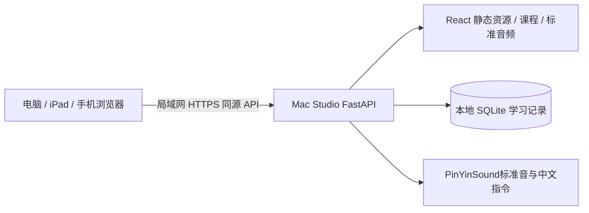

# 技术架构：自有 Mac Studio 上的 B/S

状态：家庭B/S服务、语音学习及进度已实现；当前标准音机制见ADR-0008。

## 选型与边界

前端 React + TypeScript + Vite，普通 HTML/CSS/SVG 构建轻游戏，不引入重型游戏引擎。后端 Python 3.12 + FastAPI + Uvicorn；SQLite 通过标准库访问。锁定版本见 `package-lock.json`、`uv.lock`。

当前实测主机：Apple M2 Ultra、64 GB 内存、arm64。Mac 提供家庭服务和本地课程资源。

首版不请求麦克风，不处理儿童录音。数据库保存必要的客观练习事件，不生成发音评测摘要。ASR 仅是维护者本机素材整理工具，不在应用运行时加载。

## 目录与依赖方向

| 目录                    | 职责                       | 约束                                    |
| ----------------------- | -------------------------- | --------------------------------------- |
| `src/app/`              | 页面、导航、样式           | 不直接写进度算法                        |
| `src/domain/`           | 纯类型和规则               | 不依赖 React、网络、设备 API            |
| `src/features/`（待建） | 课程、游戏、家长功能       | 每个 SPEC 独立边界                      |
| `src/platform/`（待建） | 音频播放、API client       | 后续可替换为原生适配                    |
| `server/`               | API、配对、存储            | 默认只监听 loopback；显式配置 HTTPS LAN |
| `content/` + `schemas/` | 结构化课程/原创题/资产状态 | CI 验证引用、依赖图、目标映射和完整性   |
| `private/`（不入 Git）  | SQLite、备份、授权文件     | 不由静态服务器挂载                      |
| `models/`（不入 Git）   | 本机维护工具使用的研究模型 | 固定哈希、来源、许可；不由应用启动加载  |

数据契约见 `docs/api-contract.md`、`src/domain/contracts.ts`；内容 JSON Schema 在 `schemas/`。API 版本固定 `/api/v1`，修改已有语义须迁移或新版本。

## 客户端

首版路由采用 hash 路由，适配 FastAPI 静态挂载及未来 Capacitor 本地文件路径。使用响应式布局，最小宽度 320 CSS px；支持触摸与键鼠，游戏操作应当可中断、重播和恢复。

本期浏览器只播放登记的标准音与题干音频；不申请麦克风、不生成 PCM 录音、不使用 MediaRecorder。

断互联网不影响安装完整后的局域网使用。断 LAN 或 Mac 停机则进度保存不可用，显示明确状态。首版不承诺浏览器脱离服务器仍能学习；不因此实现两套主数据与复杂同步。初次依赖/示范音获取可以联网，运行时不自动访问外部服务。

## 服务端与进度

SQLite 保存 profiles / settings / attempts / schema_migrations。开启 foreign_keys、WAL，事务提交时同时完成幂等写入与 revision 更新。小型家庭服务优先单个 Uvicorn worker。历史 schema 中预留的评分摘要字段仅为备份/迁移兼容，本期不写入新评测结果。

服务器 UTC 时间为事件时间，业务日按 Asia/Shanghai；客户端时间仅作显示参考。`requestId` 和 `attempt.id` 去重，不靠客户端请求次数累加。保留知识项稳定 ID 与内容版本，迁移中不得静默重置掌握度。

家长在 Mac 端生成短期配对码，浏览器换取同源 HttpOnly / Secure / SameSite=Strict 会话 cookie。用户不需要手机号、真实姓名或第三方账号。管理删除/导入需单独家长权限；不是解一道算术题就获得管理权限。详见 SPEC-001/005。

## 未来 Android/iOS

应用主体仍为 Web 代码；通过 Capacitor 封装时保留 API client、音频和存储接口，新增本地网络权限、证书信任及安装发布配置。本期不安装 Capacitor、不生成 Xcode/Gradle 工程。迁移不是零工作，iOS 本地网络/ATS、服务器地址发现及 app store 审核均需另立 SPEC；若未来研究发音评测，录音权限也需单独立项。[Capacitor 官方说明](https://capacitorjs.com/docs)

## 未关闭的技术门禁

1. 标准音固定采用cmguo/PinYinSound，软件不设置审音或审批；外部文件不随MIT源码分发。
2. 2025 日常修订课标的拼音具体条款原文核验与真机 HTTPS 播放均属正式发布前证据，见交付状态表。
