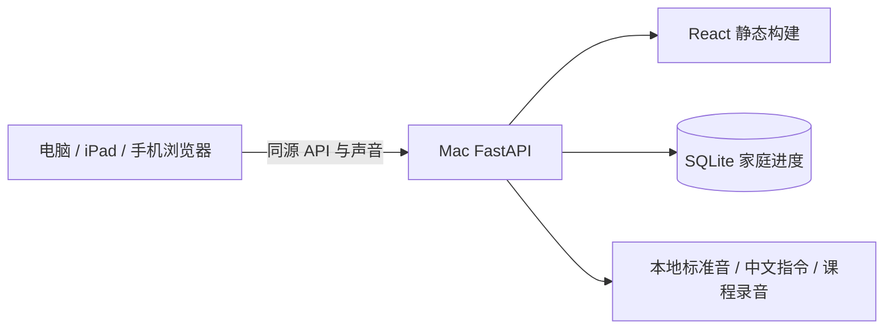

# 技术架构：自有 Mac Studio 上的 B/S

React + TypeScript + Vite 输出静态网页，FastAPI + Uvicorn 在 Mac 上提供同源网页、API和音频，Python 标准库 SQLite 保存家庭档案。版本由锁文件固定，见[依赖记录](engineering/dependencies.md)。不需要声学 worker、云服务或模型。

## 实际模块

| 路径                                                                    | 当前职责                                                                                       |
| ----------------------------------------------------------------------- | ---------------------------------------------------------------------------------------------- |
| `src/app/App.tsx`                                                       | 学习状态、导航、当前题交互与页面编排                                                           |
| `src/app/lesson-detail.tsx`、`lesson-navigation.tsx`                    | 课程资料、路线与知识卡                                                                         |
| `src/app/parent-panel.tsx`、`guest-panel.tsx`、`knowledge-progress.tsx` | 家庭/访客设置与逐知识点历史                                                                    |
| `src/app/pairing-page.tsx`、`pairing-management.tsx`                    | 初次配对与已有会话的配对管理                                                                   |
| `src/app/session-summary.tsx`、`management-controls.tsx`、`notice.tsx`  | 会话小结、家长确认及连接错误                                                                   |
| `src/platform/api-client.ts`、`pending-answer.ts`                       | 家庭/访客请求适配、待确认作答存储与重放                                                        |
| `src/domain/learning-api.ts`                                            | 学习API数据与内容类型；`app/settings-types.ts`定义设置页属性                                   |
| `src/app/styles.css`、`styles/`                                         | 保持级联顺序的样式入口与功能样式文件                                                           |
| `src/app/learning-voice.tsx`                                            | 中文声音引导与播放状态                                                                         |
| `src/app/writing.tsx`、`illustrations.tsx`                              | 书写观察与生活图片卡                                                                           |
| `src/domain/`                                                           | 契约、拼音呈现、书写与图片数据类型/纯函数                                                      |
| `src/platform/audio/browser-audio-player.ts`                            | 浏览器音频适配器                                                                               |
| `src/platform/guest.ts`                                                 | 访客临时状态与请求串行化                                                                       |
| `server/api.py`、`main.py`                                              | 路由组装与同源服务入口                                                                         |
| `server/routes/`                                                        | pairing设备配对、resources课程声音、profiles家庭资料、sessions会话、attempts作答、progress进度 |
| `server/api_dependencies.py`                                            | 认证、同源/CSRF、家长入口与时钟观察依赖                                                        |
| `server/learning_state.py`                                              | 公共题目投影、可用题筛选、复习推荐和掌握度查询                                                 |
| `server/profile_backup.py`                                              | 备份校验、历史格式迁移、事务内恢复和数据清理                                                   |
| `server/domain.py`、`storage.py`                                        | 确定性进度/选题规则、SQLite与迁移                                                              |
| `server/content.py`、`content_history.py`                               | 当前课程及不可覆盖的历史内容                                                                   |
| `server/source_audio.py`、`learning_audio.py`                           | 标准音与中文声音/课程录音清单、完整性及读取                                                    |
| `server/guest.py`、`backup.py`                                          | 请求级访客内存库、SQLite运维备份                                                               |
| `content/`、`schemas/`                                                  | 课程、答案、教学规则、资源映射及格式约束                                                       |
| `private/`（忽略）                                                      | 上游标准音缓存、模型、家庭数据库、备份及本机测试证据                                           |

按[ADR-0026](adr/0026-feature-modules.md)组织模块：页面不导入App，共享类型不依赖React；platform负责浏览器副作用。服务端路由依赖认证与学习/备份辅助模块，这些底层模块不反向导入路由。访客直接调用同样的业务函数，在请求级内存数据库内运行。进度计算仍在服务端纯函数中，不由React重复实现。详细路由和表见[API契约](api-contract.md)。

维护时先按功能定位：课程资料与练习选择看lesson模块，家长记录看knowledge-progress，通信和重连看platform，家庭导入看profiles与profile_backup。新增接口放入所属routes模块并由api组装，不向聚合入口回填业务逻辑。测试在实际所属模块注入故障或时钟。

样式入口按base、home、exercise、parent、responsive、blend-and-guest、teaching、lesson-navigation、controls、daily-reading、reading-enrichment、device-management顺序导入。前四组保存原基础规则，后续组含响应式和后加覆盖；修改规则应搜索同选择器的后续声明，新增样式放所属文件，避免随意调整导入顺序改变外观。

## 状态与一致性

家庭模式的权威状态在 SQLite。写入通过事务保存事件、幂等回执和 revision；同一实例仅有一次首次作答。按服务器 UTC 时间保存事件，业务日使用 Asia/Shanghai。每日同题计分去重由事务内查询保证，不是“日期字段唯一索引”。

会话冻结题目、内容版本和选项顺序；已登记旧内容可恢复。备份包含规则版本，进度返回当前规则标识；当前不是逐事件多版本规则执行器，未来修改算法仍须迁移规范。未知数据库迁移版本在启动写入前拒绝。

访客调用白名单操作，每次使用隔离内存 SQLite，结果快照回存浏览器 sessionStorage，不写家庭库。访客音频接口无需配对，因此能访问服务的设备可以读取已安装的教学声音；家庭进度仍受配对保护。

## 音频与网络

DAILY-06按[ADR-0025](adr/0025-buffered-daily-audio.md)为天天练短声音增加有界编码Blob池：2后台下载槽、最多1额外前台槽、请求去重与当前条优先，完整下载后复用同一媒体元素播放；当天资源上限16MiB/128项，单项4MiB。下载失败只在出声前有限重试；播放中断明确提示，不自动重播已出声片段。切份、退出及后台清池，课程长音频仍走原生Range。

标准音直接采用固定 cmguo/PinYinSound；中文题目/导航由准备阶段生成；课程录音由家长提供。运行时按登记ID和摘要读本机文件，不接受任意路径、远程URL或动态合成文本。首版不请求麦克风，不写入新发音评分。

默认只监听 loopback。家庭访问需显式 LAN IPv4 与可信 HTTPS。会话 Cookie 为 HttpOnly、SameSite=Strict，HTTPS 时加 Secure；本机 HTTP 开发不加 Secure。写操作校验 CSRF及已提供的 Origin，不配置通配 CORS。当前安全头与缺口见[隐私边界](engineering/privacy.md)。

没有 service worker 或浏览器独立离线数据库；断互联网但 LAN 可用是目标使用方式，真实断WAN验收仍待完成。Mac/LAN不可达不能假称已保存，待确认请求按原ID恢复。

## 未来扩展与验收边界

原生封装仅为后续方向，未安装 Capacitor 或生成 Xcode/Gradle 工程。届时需独立SPEC处理网络发现、权限、证书信任、后台行为和商店发布。

课程原文拼音条款核对已完成，见[课程研究](research/curriculum.md)。设备支持下限尚未冻结：Vite构建目标只是语法目标，不能代替实际 iPad、手机、Windows 和 Firefox 验收。当前证据统一见[状态表](STATUS.md)。

## 每日跟读（ADR-0014）

content/daily-reading.json保存用户PDF的14份练习和固定音频白名单；同源daily-reading/daily-audio接口提供目录与摘要校验音频，访客资源接口同样可用。中文引导与少量轻声词句朗读走既有voice接口。浏览器BrowserReadingRecorder仅保留当前条Blob，SPEC-009新增有界PCM上传家庭Mac内存与本地Whisper识别匹配，不作专业自动判分；全局播放器协调示范与回放。所有练习标记只留当前页面，不修改家庭掌握度。

按ADR-0017/0019，课程MP3、PDF及Qwen3-TTS生成的中文WAV/manifest存于resources并随当前仓库提供；应用默认读取resources/audio，支持环境变量显式配置私人资源。run.sh负责显式联网安装，普通播放与识别不下载资源。

SPEC-012按ADR-0020扩充：家庭/访客设置保存整数精度的连播间隔，适配器用AbortSignal取消等待；播放器提供真实开始与currentTime通知。content/daily-word-examples.json集中组词；content/daily-reading-timings.json绑定示范WAV和脚本摘要，服务校验后提供时间轴。维护用Qwen ForcedAligner离线生成，浏览器/运行服务不加载对齐模型。学习图片新增daily音频白名单引用，仍是同一固定PinYinSound标准来源。

READ-05/06按[ADR-0028](adr/0028-length-aware-reading-rhythm.md)补充：`readingGapSeconds`按刚播放条目的音节数计算条目间等待；`playback-preference`维护学生设备偏好与家庭默认继承。多音节标准音由`reading-word-audio`只解码当前条、保留发音边界并合为临时WAV，仍通过复用的HTML媒体元素出声；高亮读取实际播放位置与合成音节区间。单音和完整中文示范保持原路径，派生声音不落盘或持久缓存。

READ-07的`quick-gap-settings`管理紧凑入口、原生模态卡片与草稿生命周期；`playback-gap-control`共用节奏预设、加减、数值/滑杆和等待预览，分别用于学生卡片与家长默认设置。外观集中于`styles/playback-settings.css`，仅在天天练内调整共享语音开关的外观，不改变播放或持久化适配器。

设备元数据按[ADR-0022](adr/0022-device-connection-metadata.md)保存在SQLite迁移7的devices列：型号只用于显示，已用配对码不作为后续身份，last_connected_at由有效家庭认证请求用服务器时钟更新。访客临时计算不写这些记录。

家长管理按[ADR-0023](adr/0023-loopback-parent-management.md)限定为服务器127.0.0.1入口：来源与Host共同检查，启动时禁用代理头。旧远程家长Cookie保留学习访问，不能调用管理API；家庭与访客界面按服务端入口能力显示家长按钮。

文本传输与静态缓存按[ADR-0024](adr/0024-text-compression-and-public-assets.md)处理：锁定Starlette压缩JS/CSS和API文本，媒体及Range保持原字节；家庭API不缓存，哈希构建资源与字体按独立策略缓存。连接检测只在当前浏览器测现有同源资源，不增设数据收集服务。

游戏乐园按[ADR-0031](adr/0031-household-game-budget.md)拆分：src/app/game-zone.tsx与game-settings.tsx展示入口/效果/设置，use-game-clock.ts负责短授权失效时锁界面；content/games.json是唯一玩法和时间策略目录。server/game_policy.py纯函数结算共享授权区间，game_service.py负责事务内读写/守卫，routes/games.py提供接口；原sessions/attempts继续冻结题单、保存唯一首次成绩。SQLite迁移8的household列保存分钟与版本化时钟，sessions.game_id保存玩法来源；家庭备份与访客快照复用原事务。
