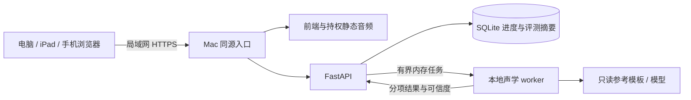

# 技术方案与选型调研

日期：2026-09-25。最终约束：B/S 架构；前端在电脑/iPad/手机浏览器运行；服务端是用户自有 Mac Studio M2 Ultra / arm64 / 64 GB；录音只在浏览器与该 Mac 之间流动。自动评分在首版范围内，合格评分模型仍需 PoC。本文是实现方案，环境实际完成项见工程验证记录。

## 1. 推荐栈及比较

采用 React + TypeScript + Vite，标准 HTML/CSS/SVG 为主要交互层，Vitest 验证领域逻辑，Playwright 验证跨浏览器行为。Mac 使用 Python 3.12 + FastAPI + Uvicorn 提供 API，SQLite 保存最小进度，本地独立 worker 运行声学处理。所有依赖固定版本，具体版本只在锁文件和 [依赖记录](../engineering/dependencies.md) 维护。

| 选择                           | 适配程度                                         | 本次决定                                                            |
| ------------------------------ | ------------------------------------------------ | ------------------------------------------------------------------- |
| React/Vue + TypeScript + Vite  | 都能以 DOM 实现触摸/键盘交互并输出静态前端产物   | 选 React，统一组件约定与交付格式；不是因为 Vue 无法满足             |
| Next.js 等全栈 SSR             | 有服务渲染和路由能力，但课程主要是交互与本地 API | 暂无 SSR 必需需求，不叠加第二个服务端框架                           |
| Phaser/Canvas 为主             | 适合持续运动、碰撞和精灵场景                     | 首版选择/配对/拼搭更适合 DOM；若新增实时动作玩法再局部引入          |
| Flutter Web / React Native Web | 有跨平台价值，但增加当前浏览器开发与调试路径     | 原生 App 非本期，不采用                                             |
| 全浏览器 WASM 评分             | 可在设备运行，减少 Mac 依赖                      | 非用户当前部署选择；手机资源/模型分发约束更大，留作后续可选 adapter |
| Mac Python API + worker        | 便于声学工具、模型版本和测试集共用               | 采用；进程隔离避免 CPU 推理阻塞异步请求                             |
| Node 全后端                    | 通信简单，但 Python 声学研究组件更多             | 前端工具仍用 Node，声学服务集中 Python                              |
| PostgreSQL/Redis               | 适合更多用户和水平扩容                           | 当前家庭/小范围单机以 SQLite + 有界内存队列开始                     |

事实依据：[React 交互模型](https://react.dev/learn/adding-interactivity)、[Vue 简介](https://vuejs.org/guide/introduction.html)、[Vite 静态构建](https://vite.dev/guide/build)、[Phaser 定位](https://docs.phaser.io/phaser/getting-started/what-is-phaser)、[Flutter Web](https://flutter.dev/development/web)。访问日期均为 2026-09-25；复杂度取舍是本项目判断。

## 2. 模块和边界

前端：课程呈现、游戏状态、输入适配、音频播放、采音、评测结果显示。内容规则、拼音匹配规则和掌握度规则是纯函数，不能绑 DOM。前端不持有供应商密钥，不含第三方语音 SDK，不写录音到分析服务。

后端：校验任务目标和音频格式、限制时长/体积、投递 worker、转换为统一结果，按需持久化最小进度。worker 独立于 API 进程，预加载只读参考库/模型，处理完释放原始录音与中间声学张量。默认不输出录音、Base64、转写、设备身份到日志。

可替换接口：`ContentRepository`、`ProgressRepository`、`AudioPlayer`、`Recorder`、`AssessmentClient`；服务端 `AssessmentEngine` 分开 DSP PoC、未来音素模型及可选授权 SDK。实现阶段签名和错误码统一由 SPEC 冻结，不让每个游戏自行解释分数。

SQLite 保存 profile 的本地匿名 ID、已选课程进度、题目结果、评分摘要、引擎/内容版本；不存原始录音。多个客户端读写同一 Mac；事务和唯一 attempt ID 避免重复提交，多次重试不能反复增加掌握度。数据库迁移版本化，导出/清除在家长区提供。

## 3. 采音与评测传输

### 输入合同

实现首选 AudioWorklet 获取 PCM，按实际 `AudioContext.sampleRate` 记录来源采样率，浏览器或服务端进行确定性重采样，API 的标准输入采用单声道 PCM WAV（16 bit / 16 kHz），且明确验证 WAV 头和数据长度。申请 `sampleRate: 16000` 不能当成设备真的交付 16 kHz；不可改 WAV 头冒充重采样。AudioWorklet 的采样率来自音频上下文。[MDN sampleRate](https://developer.mozilla.org/en-US/docs/Web/API/AudioWorkletGlobalScope/sampleRate)（2026-09-25）。

项目初始限制为单次最长 10 秒、最大 512 KiB，与 [API 契约](../api-contract.md) 一致。录音质量门禁需按任务类型调整，不能因短促的正确辅音拒绝全部短音。持续按下并非唯一操作：支持点击开始/点击停止，10 秒自动停，随时取消；切后台、中断、页面离开要释放麦克风 track。

MediaRecorder 可用于本地回放/备选采集，但必须 `isTypeSupported` 探测并按真实 `mimeType` 保存。Safari 18.4 已新增 WebM/Opus，不能写死“Safari 只能 MP4”。若走压缩录音上传，需要固定服务器解码器及其许可，不能假设 Python 标准库能读所有 WebM/AAC。首版采用 PCM 以减少这一依赖。[WebKit 更新](https://webkit.org/blog/16574/webkit-features-in-safari-18-4/)、[MDN MediaRecorder](https://developer.mozilla.org/en-US/docs/Web/API/MediaRecorder)（2026-09-25）。

### 请求生命周期

`idle → permission → recording → processing → result`；取消与错误是显式状态。录音前停止示范音，避免把扬声器示范录入；录音中关闭奖励音效。提示使用安静环境，信号过小/削波/无声进入重录，不给“发音错误”结论。

每次请求带固定 target ID、content version、attempt ID 和 WAV；客户端不能提交任意“标准答案文本”让服务端误匹配。服务端从已审核内容库解析评分目标，检查此目标是否有可用引擎及模板。以随机 attempt ID 做短时幂等去重，仅保留摘要和任务状态；遇到限流、模型缺失、服务不可达，保持未评分。

Mac API 不设录音存档接口。若框架 multipart 实现会把大文件暂存磁盘，需改用带上限的原始 `audio/wav` body、限制实际读取字节或显式控制流式缓冲；不能只在文档写“内存处理”却默认落 `/tmp`。同时检查反向代理 request buffering、崩溃转储、应用日志、开发调试和备份路径。

## 4. 本地评分研发路线

第一候选是 `NumPy/SciPy/librosa → 预处理/声学特征 → 多模板对比 → 校准器 → 结构化结果`。只有最终校准器可产出孩子看到的分数，其版本与参考库版本必须进入结果。

| 层         | 原型工作                                               | 不允许的替代                           |
| ---------- | ------------------------------------------------------ | -------------------------------------- |
| 质量判断   | 有效发声、削波、背景声、断头断尾、有效有声段           | 把响度当准确率                         |
| 声韵区分   | MFCC/频谱/时长对比正确与常见混淆候选，按目标类型提特征 | 只比较一个成人模板、对任意距离套百分制 |
| 声调       | 有声区间 F0 与归一化轮廓，针对本调/语境分别校准        | 对清辅音输出声调分；绝对音高越高越好   |
| 置信与拒判 | 明确低置信、噪声、未知目标和未覆盖人群                 | 所有音频必出高低分                     |
| 校准       | 教师双标、按说话人隔离、固定阈值、分群检查             | 使用测试集调参再公布同一测试成绩       |

DSP 首次原型用 CPU 运行，初始 1 个执行槽、最多排队 2 个、每设备 1 个任务。初始产品性能目标与 [SPEC-000](../specs/SPEC-000-offline-assessment-poc.md) 一致：10 秒以内片段，热模型服务端 p95 ≤ 3 秒，局域网端到端 p95 ≤ 5 秒；并发请求包含执行与等待路径，不能误解为已启用多个推理进程。补充耐久验收：连续 100 次不泄漏内存、不写录音、不外连。这些是待测门槛，不能从 Mac 配置推断已经达标。API 队列满时返回忙碌及重试，不无限排队。

本阶段已在 arm64 主机安装并锁定 `assessment-poc` 依赖组（librosa / NumPy / SciPy），合成 220 Hz 正弦经 YIN 测得约220.24 Hz。该结果只验证依赖可导入和基本声学计算执行，不是人声、声调、儿童发音或评分效果验证。评分 API 当前仍返回503未就绪；依赖工程验证不能解除 SPEC-000 门禁。

后续音素模型若引入 ONNX Runtime，则 CPU 是先验收路径，Apple CoreML/MPS 属于优化候选；不能因为模型可导出 ONNX 就保证全部算子、精度、发音任务适配。PyTorch/ONNX/MFA 的依赖应建独立推理 extra/环境，不让前端安装承担训练框架。模型下载由显式准备脚本执行，固定 revision 与 SHA-256；运行时从本地路径加载并禁自动更新、禁下载、禁第三方遥测。

浏览器 ONNX Runtime Web 的 WASM 路线技术上可行，但其文档与较新 WebGPU 支持说明可能不同步；本期不依赖 WebGPU，也不以某浏览器当前宣称支持作为跨端评分证明。[ONNX Web](https://onnxruntime.ai/docs/tutorials/web/)、[部署说明](https://onnxruntime.ai/docs/tutorials/web/deploy.html)。访问 2026-09-25。具体模型/权利缺口见 [语音调研](audio-and-assets.md)。

## 5. 局域网 HTTPS 和安全边界

移动设备访问 `http://192.168.x.x` 不享有开发机 `localhost` 的安全上下文待遇；`getUserMedia` 要求安全上下文和用户许可。因此“Vite 用 --host 后手机能打开页面”不等于麦克风可用。[MDN getUserMedia](https://developer.mozilla.org/en-US/docs/Web/API/MediaDevices/getUserMedia)（2026-09-25）。

推荐本地可信 CA 签发固定局域网主机名/IP 的 HTTPS 证书，由 Mac Uvicorn TLS 入口提供同源前端和 API（未来可按需加反向代理）；受信任 CA 仅安装到参与的个人设备，私钥只留 Mac。需要写清 iPad/iPhone 的证书安装与完全信任步骤，由设备所有者执行；不通过浏览器关闭安全保护绕开。证书、配对令牌、数据库、私有语料不入 Git。

开发服务默认监听 loopback；面向家庭设备时显式启用 LAN listener、限定接口/防火墙范围。Mac 入口使用短期配对与本地会话，不靠“家里 Wi-Fi”作为唯一访问控制。原生前端静态文件和 API 同源，避免任意 CORS；接口验证 Origin/会话并限制请求大小、并发和速率，防其他网页滥用麦克风结果或消耗推理资源。不做公网端口映射，不依赖外网穿透服务。

“无第三方录音外传”验收：Mac 断 WAN 保留 LAN，完整做采音、自动评分、结果保存；客户端和服务端抓取出站连接，生产构建不得请求第三方字体/CDN/统计/语音服务。模型需已准备到本机，缺失时清晰未就绪，不后台上网补齐。

## 6. 浏览器与输入适配

采用能力检测及实机矩阵，不把 viewport 模拟当作 iPad 测试。最低产品版本在首次真机验证后冻结；建议测试当期及前一个主要版本的 Chrome/Edge、Safari/iPadOS、iOS Safari、Android Chrome，桌面 Firefox也做核心路径。构建语法目标与运行 API 是两件事，Vite 不会自动补齐麦克风等浏览器能力。[Vite 浏览器目标](https://vite.dev/guide/build)（2026-09-25）。

| 场景           | 强制验收                                                                        |
| -------------- | ------------------------------------------------------------------------------- |
| 电脑键鼠       | Tab/Shift-Tab 可达，Enter/Space 作答，焦点清楚；鼠标无 hover 依赖               |
| iPad 触摸/键盘 | 横竖屏切换、分屏、小键盘与屏幕键盘、取消触摸、音频中断后恢复                    |
| 手机           | 320 CSS px 起无横向溢出、安全区、滚动、音量状态、后台回来可重录                 |
| 拖拽拼搭       | Pointer Events；pointercancel 后恢复；另有点击选中再点目标与键盘完成方式        |
| 音频           | 首次点击后解锁播放，处理 play() rejection，快速连点只保留最新示范，切课停止旧音 |
| 录音           | 允许、拒绝、权限等待、设备无麦克风、蓝牙切换、后台中断、Mac失联                 |

触控主目标建议至少 48×48 CSS px，按钮间有明显间隔；这是针对一年级的项目设计标准。WCAG 2.2 要求拖拽操作提供无需拖拽的单指方式，键盘也应可操作。[W3C 拖拽准则](https://www.w3.org/WAI/WCAG22/Understanding/dragging-movements)、[Pointer Events](https://developer.mozilla.org/en-US/docs/Web/API/Pointer_events)。访问 2026-09-25。

不自动大声播放；示范音由明确按钮触发，重播无惩罚。媒体策略会拒绝未获允许的自动播放，处理 Promise 失败和 AudioContext 暂停，不能静默卡住。[MDN 自动播放](https://developer.mozilla.org/en-US/docs/Web/Media/Guides/Autoplay)（2026-09-25）。

## 7. 缓存、更新和未来原生

前端可缓存课程和持权静态音频，但当前核心依赖 Mac API，离线缓存不代表无 Mac 仍能评分。PWA 安装和 Service Worker 后置，待缓存版本、旧课程引用、更新中断和空间回收测试齐备再引入；不必为本阶段脚手架增加插件。浏览器存储可能被回收，权威进度在 Mac SQLite；避免“永不丢失”的承诺。[MDN 存储回收](https://developer.mozilla.org/en-US/docs/Web/API/Storage_API/Storage_quotas_and_eviction_criteria)（2026-09-25）。

未来 Android/iOS 可用 Capacitor 包装前端；其 Web API 与插件边界适合替换 Recorder/Storage adapter，但原生权限、局域网访问授权、HTTPS信任、后台行为、商店规则仍需新增 SPEC 和实测。代码尽量保持 Web 标准，并不承诺零改动上架。Capacitor 是 MIT；本期无需安装 Android Studio/Xcode 工程或提交原生包。[官方概述](https://capacitorjs.com/docs)、[安装要求](https://capacitorjs.com/docs/getting-started)、[许可](https://github.com/ionic-team/capacitor/blob/main/LICENSE)（2026-09-25）。

## 8. 可交接与仍需专业判断的范围

较低成本模型可按冻结 SPEC 实现界面、游戏状态机、API适配、manifest校验、进度持久化、日志脱敏及测试。评分核心的阈值校准、数据许可、儿童发音内容审核与质量验收不能以自动代码完成替代。一次提交只落实一个已定义验收的任务；任何模型或素材依赖缺失需返回真实未就绪，并记录待办。
